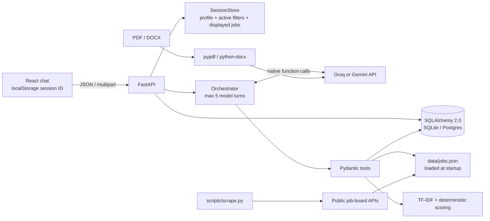

# AIJob

AIJob is a single-service conversational job assistant. It accepts PDF or DOCX resumes, extracts a structured profile with Groq or Gemini, ranks real listings from the checked-in JSON catalog, and records applications in SQLAlchemy-backed storage. The React client is built into `client/dist` and served by FastAPI.

## Architecture



### Turn data flow

1. The browser creates an anonymous UUID in `localStorage` and sends it with each request.
2. Resume upload is size/type checked, text is extracted, then the configured provider returns a Pydantic-validated profile. The profile is stored in SQLite/Postgres; the active session also keeps it in memory.
3. The orchestrator passes the conversation and Pydantic-derived tool schemas to the selected provider's native function-calling API. At most five model turns/tool actions are processed for one chat request.
4. `recommend_jobs` applies hard filters first, then computes `0.50 × skill overlap + 0.25 × TF-IDF title similarity + 0.15 × experience fit + 0.10 × location preference`. Match reasons are derived from the listing and profile data.
5. Apply/list actions use SQLAlchemy. `(session_id, job_id)` is unique in the database; duplicate insertion races are caught and reported with the original application date.
6. The API response includes text, tool chips, profile, job cards, and/or application records. The client never receives provider stack traces.

## Job data

`data/jobs.json` contains 1,800 normalized listings collected from the public Arbeitnow and Jobicy APIs. Each listing preserves its original source link and source attribution. IDs are sequential within the checked-in snapshot. Current snapshot statistics can be reproduced with:

```bash
python scripts/scrape.py --target 1800
```

The scraper supports Arbeitnow, Remotive, Jobicy, Himalayas, and RemoteOK public APIs. It checks each host's `robots.txt`, skips sources whose access policy cannot be verified, uses bounded retries/timeouts and per-host delays, strips markup, extracts skills/experience, deduplicates by title/company/location, and prints coverage statistics. Keep source links and attribution intact when refreshing or displaying listings. Review each provider's current API terms before production refreshes; in particular, honor Remotive's stated request frequency and attribution requirements.

## Local setup

Requirements: Python 3.11+, Node.js 22+, and npm.

```bash
python3 -m venv .venv
source .venv/bin/activate
pip install -r requirements.txt

cp .env.example .env
# Set GROQ_API_KEY in .env (or GEMINI_API_KEY to use Gemini).

cd client
npm ci
npm run build
cd ..

uvicorn server.app.main:app --reload
```

Open `http://localhost:8000`; API documentation is at `http://localhost:8000/docs`. For client hot reload, run `npm run dev` in `client/` in a second terminal; Vite proxies `/api` to port 8000.

Run tests:

```bash
python -m pytest -q server/tests
```

## API

| Method | Path | Description |
| --- | --- | --- |
| `POST` | `/api/chat` | JSON `{ "session_id": "...", "message": "..." }`; returns reply, tools used, jobs, applications, and profile |
| `POST` | `/api/upload` | Multipart `session_id` and `file` (PDF/DOCX, up to 5 MB) |
| `GET` | `/api/applications?session_id=...` | Lists this anonymous session's recorded applications |
| `GET` | `/api/health` | Health status, loaded listing count, and LLM configuration status |
| `GET` | `/docs` | OpenAPI/Swagger documentation |

## LLM and job sources

- **LLM:** Groq via the official `groq` Python SDK and native function calling, or Gemini via the official `google-genai` SDK. When both keys are configured, Groq is selected. Set `GROQ_API_KEY`; `GROQ_MODEL` defaults to `llama-3.3-70b-versatile`. Gemini remains available with `GEMINI_API_KEY` and `GEMINI_MODEL` (default `gemini-2.5-flash`). Transient timeout/rate-limit/server failures receive bounded exponential retries.
- **Job feeds:** Arbeitnow, Remotive, Jobicy, Himalayas, and RemoteOK API adapters are implemented in `scripts/scrape.py`. The committed snapshot currently includes Arbeitnow and Jobicy records. Application buttons use the listing's source URL; see [Applying to jobs](#applying-to-jobs) for the confirmation and submission behavior.
- **Resume readers:** `pypdf` for text-based PDFs and `python-docx` for DOCX. OCR/scanned PDFs are not supported.
- **Matching:** scikit-learn TF-IDF title similarity; skill synonyms and the remaining scoring/filter logic are deterministic Python.

## Configuration

| Variable | Default | Purpose |
| --- | --- | --- |
| `GROQ_API_KEY` | empty | Groq API key; preferred provider when set |
| `GROQ_MODEL` | `llama-3.3-70b-versatile` | Groq model name |
| `GEMINI_API_KEY` | empty | Optional Gemini API key; used when Groq is not configured |
| `GEMINI_MODEL` | `gemini-2.5-flash` | Gemini model name |
| `DATABASE_URL` | `sqlite+aiosqlite:///./data/aijob.db` | SQLAlchemy async database URL; use `postgresql://...` for hosted Postgres |
| `JOBS_FILE` | `data/jobs.json` | Startup-loaded, read-only job catalog |
| `CLIENT_DIST` | `client/dist` | Built React assets served by FastAPI |
| `MAX_RESUME_BYTES` | `5242880` | Upload size limit |
| `LLM_MAX_RETRIES` | `3` | Bounded retries for transient provider errors (1–8) |
| `REAL_APPLY_ENABLED` | `false` | Enable the final send/submit action after a user confirms |
| `SMTP_HOST` | empty | STARTTLS SMTP server for email applications |
| `SMTP_PORT` | `587` | SMTP server port |
| `SMTP_USER` | empty | Optional SMTP username |
| `SMTP_PASS` | empty | Optional SMTP password |
| `SMTP_FROM` | empty | Sender address used for real application emails |

## Applying to jobs

Application actions use a two-step confirmation. AIJob first shows the job, the application plan, and a **Yes, submit** confirmation. Nothing is sent or submitted until the candidate explicitly confirms in a later action. `REAL_APPLY_ENABLED=false` is the default; in this mode email and ATS forms are prepared as dry runs and the final send/submit is skipped.

Supported paths:

- **Email:** Listings with a provided contact email get a prepared message with the candidate's contact information and PDF/DOCX resume attached. Real delivery uses STARTTLS and `SMTP_HOST`, `SMTP_PORT`, `SMTP_USER`, `SMTP_PASS`, and `SMTP_FROM`.
- **Greenhouse and Lever:** The assistant opens the listing form, fills standard candidate fields when available, and attaches the resume. Lever links are opened at the `/apply` path. On explicit confirmation with real mode enabled, the assistant submits and only reports success if the page displays a receipt/confirmation message.
- **Manual:** Other job boards are recorded as needing manual action and include the original listing link. The assistant does not claim these applications were submitted.

CAPTCHA pages are never solved or bypassed. Required custom questions are not guessed; if any remain unanswered, the assistant stops and directs the candidate to finish manually. Third-party form selectors can drift, so a dry run should be checked against the current posting before enabling real submissions. Uploaded resumes contain personal information and are stored under `uploads/{session_id}/resume.<ext>` on disk; protect that storage and use persistent storage appropriate to the deployment. The Docker image is larger because it includes headless Chromium and browser dependencies. Allocate at least **2 GiB memory** to the service on Google Cloud Run.

To enable actual sending/submission, configure the SMTP values for email applications and set `REAL_APPLY_ENABLED=true`. Test with it disabled first. Keep the feature user-driven: one job at a time, only after explicit confirmation.

For hosted deployments use Postgres (Neon/Supabase URLs are supported) so profiles and applications survive service restarts and multiple instances. SQLite is intended for local development.

## Docker deployment

Build and run locally:

```bash
docker build -t aijob .
docker run --rm -p 8000:8000 \
  -e GROQ_API_KEY="$GROQ_API_KEY" \
  -e DATABASE_URL="$DATABASE_URL" \
  aijob
```

The multi-stage image builds the React client with Node 22 and runs the combined service on Python 3.11. It installs headless Chromium and its system dependencies, increasing the image size; configure Google Cloud Run with at least 2 GiB memory. Configure `GROQ_API_KEY` (or `GEMINI_API_KEY`) and a persistent Postgres `DATABASE_URL` as secret environment variables in the hosting provider; do not bake secrets into the image.

### Render

1. Push this repository to a Git provider and create a Render **Web Service** using the Docker runtime.
2. Add `GROQ_API_KEY` and `DATABASE_URL` in the service's environment settings; set `GROQ_MODEL` if needed.
3. Deploy. The service listens on Render's injected `PORT`; use `/api/health` for the health check.
4. Use the public `onrender.com` URL from the completed deployment. Render service creation requires an account and its associated credentials/billing choices.

### Google Cloud Run

1. Create a Cloud Run service with a container build from this repository (or build/push the Docker image to Artifact Registry).
2. Configure `GROQ_API_KEY` and `DATABASE_URL` through Secret Manager-backed environment variables.
3. Allow unauthenticated invocation if the app should be public, then deploy and use the service URL returned by Cloud Run.
4. Check `/api/health` on the resulting URL.

## Limitations

- Chat requires a valid Groq or Gemini API key and provider access. No local model or intent-keyword fallback is used.
- Resume extraction is text-based only; scanned images/OCR, multi-language guarantees, and full contact validation are out of scope.
- Active filters and the last displayed result list are held in process memory. Profiles and applications persist in the database; a restart clears the transient refinement/display state.
- Listings are a point-in-time snapshot and can expire. Always verify details and apply through the original source link.
- An application record is an AIJob tracker entry, not a submission to an employer.
- Anonymous session IDs are client-generated and are not authentication; do not store sensitive personal data in a publicly shared browser profile.
